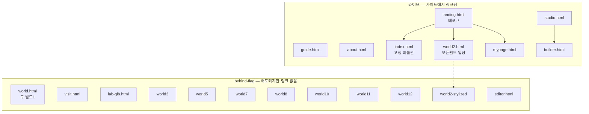
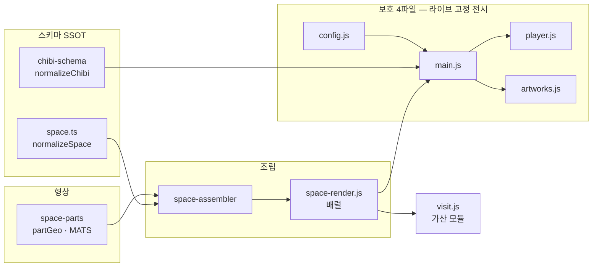
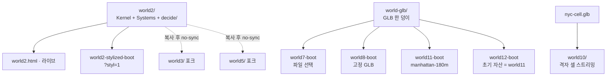
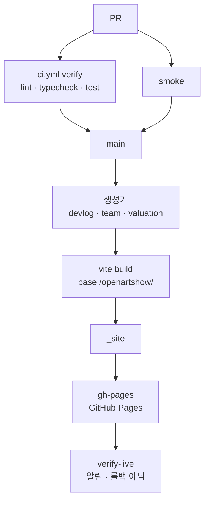

# OpenArtShow 전체 구조 (Mermaid)

> 이 파일은 **그림**이다. 규칙의 SSOT 는 [`ARCHITECTURE.md`](./ARCHITECTURE.md) 이고,
> 진입점 노출의 SSOT 는 [`scripts/lib/entrypoints.mjs`](../scripts/lib/entrypoints.mjs) 다.
> 그림과 코드가 어긋나면 **코드를 따른다.**
>
> 기준: `world12` 슬롯 포함 (behind-flag). 라이브 오픈월드는 **world2**.

## 1. 방문자가 닿는 면

## 2. 런타임 층

보호 파일은 `visit.js` 를 **import 하지 않는다.**

## 3. 월드 계보

`world4` · `world6` · `world9` 는 결번이다.

## 4. 데이터가 화면에 닿기까지

서버에 전시 DB 는 없다. 방문자 브라우저는 기본적으로 **우리 호스트만** 본다.
예외: PeerJS 시그널링 · YouTube nocookie · `img-src https:`.

## 5. 배포

`verify` 가 실패하면 `deploy` 는 뜨지 않는다. `verify-live` 실패는 이미 나간 배포를 되돌리지 않는다.
